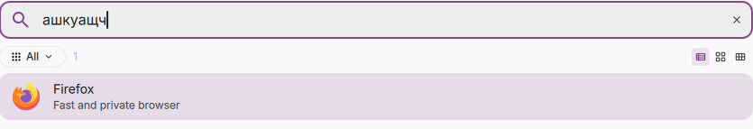

# DMS Keyboard Layout Search

Find apps in [DankMaterialShell](https://github.com/AvengeMedia/DankMaterialShell)
without switching keyboard layouts first. For example, typing `ашкуащч` on a
Russian layout finds **Firefox**, and typing `ucp.urq` on Dvorak finds it too.



The plugin adds hidden keywords to DMS's existing application index. It works
in the application launcher and Niri overview, with no trigger prefix. Normal
search, original app names, launch commands, hidden-app filtering and usage
history stay in use.

**Publication status:** prepared locally; not yet published to GitHub or the
DMS registry. Repository and registry URLs in `packaging/` are planned targets.

## Layouts

By default, the plugin reads the **actual Wayland keymap** using `xkbcli`. It
includes each configured layout plus a US reference map. This preserves the
session's layout variants and custom key positions instead of guessing from a
language code. It reads a keymap snapshot, not keyboard events.

Alternatively, open the plugin's settings and enter XKB codes such as:

```text
us,ru
us,de,fr
us,gr,ara,il
us(dvorak),us(colemak),tr
```

Any layout or variant available to your system's XKB database can be selected;
there is no fixed language list in the plugin. Up to eight layouts can be
configured at once, plus the US reference. Manual mode uses the standard
`evdev` rules and `pc105` model; use automatic mode to reflect a custom keymap.

Reload the layouts from the settings button after changing your compositor's
keymap. A plugin restart also takes a new snapshot. Newly installed apps and
custom app names are reindexed automatically. There is no polling and no
persistent helper process; Python runs briefly when loading layouts.

## Requirements

- DMS **1.6.2 or newer**; runtime tested on 1.6.2 with Niri.
- Python **3.9+**, `libxkbcommon`, and an XKB data package (`xkeyboard-config`
  or `xkb-data`). The helper uses Python's standard library; no pip packages.
- `xkbcli dump-keymap-wayland` for automatic detection. Manual layout selection
  also works when this subcommand is unavailable.

On Arch, the relevant packages are `python`, `libxkbcommon`, and
`xkeyboard-config`. Debian/Ubuntu package names include `python3`,
`libxkbcommon0`, `libxkbcommon-tools`, and `xkb-data`.

The index integration is compositor-independent. Only **Niri has been tested
in a live desktop session**; other Wayland compositors should be verified
before claiming runtime support. Manual mode needs no compositor IPC.

## Local installation

From this repository's directory:

```sh
mkdir -p ~/.config/DankMaterialShell/plugins
ln -s "$PWD/plugin" ~/.config/DankMaterialShell/plugins/keyboardLayoutSearch
dms ipc call plugin-scan scan
```

If the destination already exists, check it and move the old installation
aside first. Enable **DMS Keyboard Layout Search** in DMS Settings → Plugins.
The status text in its settings shows the loaded layouts or an actionable
error. No bar widget needs to be added.

Disable the plugin in the same panel to restore the original application
metadata, or run:

```sh
dms ipc call plugins disable keyboardLayoutSearch
```

## Boundaries

- Conversion follows **physical key positions**, not pronunciation or
  translation. It covers direct text on XKB's base and Shift levels.
- AltGr/level-three combinations, Compose sequences, dead-key sequences and
  IME composition/conversion (for example Chinese input or Japanese kana-to-
  kanji conversion) are outside its scope. Direct Unicode symbols in a keymap
  are supported, including keys that emit multiple codepoints.
- Search uses additional keywords. Ranking and typo tolerance can differ from
  a direct app-name match. Reconstructing ambiguous duplicate character
  positions is approximate; unshifted positions are preferred.
- App names, generic names, IDs and existing keywords are indexed. Files,
  clipboard content, web searches, application actions and DMS built-in
  commands are not extended.
- Automatic mode reads the seat/keymap returned by `xkbcli`; it does not merge
  multiple seats or independent per-device maps.
- The plugin currently uses internal `AppSearchService` properties. Future DMS
  changes may require an update. A failed keymap refresh retains the last
  working index and displays the error.

See [compatibility and verification](docs/compatibility.md) for actual test
coverage rather than a claim that every input method works.

## Development

```sh
make test            # Python, Node and manifest checks
make test-component  # Offscreen Quickshell lifecycle checks with isolated stubs
make test-live       # Read-only smoke test against this machine's running DMS
make coverage        # Compile all installed XKB layouts and variants
make reload          # Validate, hot reload this linked plugin, wait for its index
make package         # Validate and create a local source archive in dist/
```

Development requires Node.js, Make, and Quickshell for component tests. The
live smoke test expects Firefox, Telegram, Zed and Files to be installed.
QML hot reload can retain imported JavaScript in Qt's cache: after changing
`LayoutMaps.js`, restart DMS once before relying on live test results.

Diagnostics:

```sh
dms ipc call keyboard-layout-search status
dms ipc call keyboard-layout-search refresh
dms ipc call keyboard-layout-search search 'ашкуащч'
```

`plugin/` is the installable plugin; `tests/` and `scripts/` contain validation
and local packaging tools. [Publication steps](docs/releasing.md) and the
prepared [registry entry](packaging/registry/korbash-dms-keyboard-layout-search.json)
are included. Nothing in `make package` publishes, uploads or changes a remote.

MIT license, © 2026 korbash.
